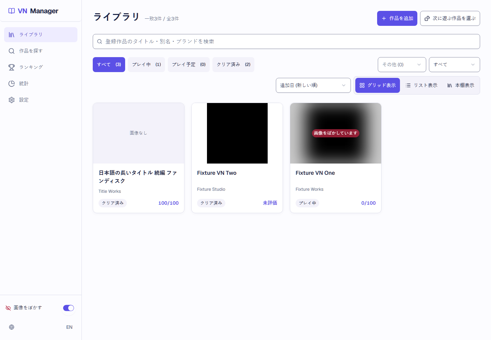
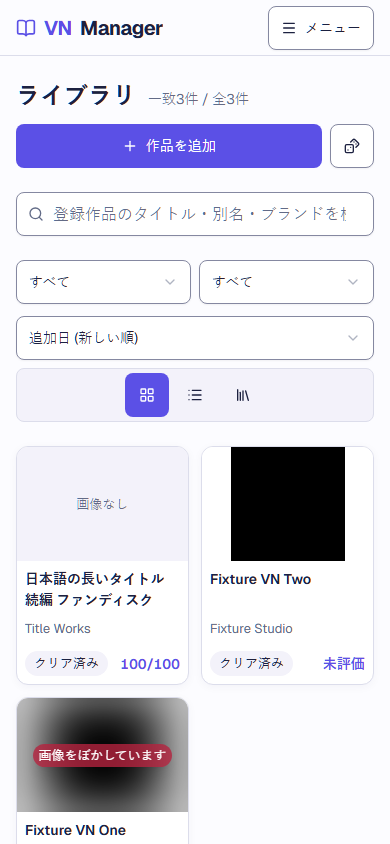
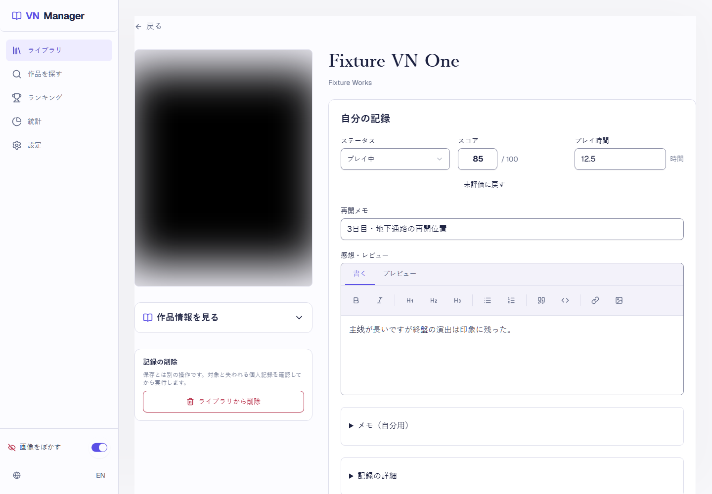
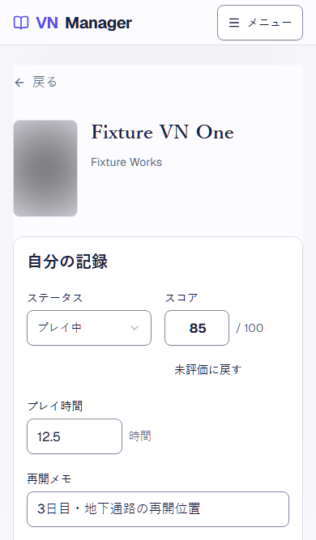
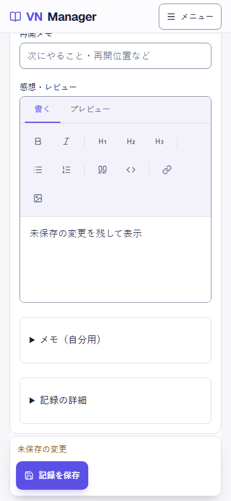

# V2-14 回帰・公開前確認

## 判定

- 検証対象base: `origin/develop-v2` / `fa3e192f04de1a925ab95e15b74f08375f026202`。PR #125（#54の下書き復元E2E、merge `8140fcaa93f20839688169180b3bd6cfa6c72cd0`）、PR #126（#53のアクセシビリティ修正、merge `e5f0407b954279de04d88c6ee47e6657cb656752`）、PR #128（修正後Axe 72条件の記録、merge `fa3e192f04de1a925ab95e15b74f08375f026202`）を含む。確認後に`git fetch origin develop-v2`を実行し、ローカルbaseも同SHAだった。
- 最新のdevelop-v2 Quality checks run [37917802438](https://github.com/neco75/vn-manager/actions/runs/37917802438) は2026-10-09 10:33:39 UTCにsuccess。`gh run view`でheadはbaseと同じ`fa3e192f04de1a925ab95e15b74f08375f026202`、Quality checks job successを確認した。ログではE2E 114件pass、audit moderate 2件・high以上0件。
- base SHA `fa3e192`のPreview deployment [6958473988](https://github.com/neco75/vn-manager/deployments/6958473988) はGitHub deploymentのenvironment `Preview` / head `fa3e192f04de1a925ab95e15b74f08375f026202` / status `success`。URLは[こちら](https://vn-manager-40e6k27um-neco75s-projects.vercel.app)。
- 同一base SHA `fa3e192f04de1a925ab95e15b74f08375f026202`上の`CI=1 npm run check:review`を別worktreeで実測し、exit 0を確認した。regression、unit 98/98、lint（既存warning 3件）、typecheck、build、E2E 114/114、audit high以上0件（moderate 2件）。この作業treeでの再実行は、並行worktreeのfixture serverがport 3101を使用中でPlaywright開始前に終了したため、成功結果は同一SHAの完了済み実測を参照する。
- このPRはQA証跡のみを更新する。アプリ本体、DB、依存パッケージ、保存形式の変更はない。Playwrightは既存VNDB fixtureと隔離BrowserContextを使い、実データ・実VNDBへ接続しない。

## 採用画面と実画面

親Issue #76 の[2026-10-07確認コメント](https://github.com/neco75/vn-manager/issues/76#issuecomment-6036035422)には、PR #108統合後のPreview画面とPC/スマホ画像をユーザーへ提示し、「ok」の返答を受けたとある。これは第1段階の一覧→詳細→保存→戻るだけを次へ進める確認として扱う。全体Previewに対するユーザー最終確認は未取得で、Issue #76/#90はopenのまま。今回も認証付きPreviewの手動操作はVercel認証が `account_not_found` となり未確認で、ユーザーの実ブラウザや実データを使った操作はしていない。

採用したコンセプトは画面の方向を示す架空の6作品モック。実UIは保存済みレコードと既存機能を表示するため内容と補助操作が異なる。既存の状態・所有フィルター、12種の並べ替え、grid/list/shelf、件数、ルーレットは仕様に沿って維持している。E2E画像は架空fixtureを使うため、VNDB実作品の表紙画像とは異なる。

| 採用画像 | 実UIとの差 | 理由 |
| --- | --- | --- |
| [一覧案](references/library.png) | コンセプトは6作品のイラストと単一の状態列。実画面はfixtureの3作品、状態と所有の選択、並べ替え、3つの表示形式、検索一致件数を表示する。 | 実保存データとSPECの既存操作を維持するため。表紙なしの長い日本語タイトル、画像ぼかし、0点、未評価のfixtureを含む。 |
| [詳細案](references/detail.png) | コンセプトは大きな架空表紙、状態/評価/時間、再開メモと感想。実画面は保存済み作品の2列記録配置で、所有・日付・購入先・非公開メモ・削除確認も維持し、編集中のみ保存バーを出す。 | 既存LibraryItemの全項目と操作を保持し、追加機能や情報を画像から新設しないため。 |

### 実画面

PC 1440×1000の一覧画像はPR #126統合後の画面を既存Playwright fixtureで再取得した。状態フィルターがTab列からラベル付きボタングループになり、ボタン幅に合わせて行の配置が変わる。スマホ390×844の一覧は状態Selectを使うため、この変更の影響を受けず、詳細390×667と編集中の保存バー画像も#125/#126の変更対象ではない。これらの既存画像は現状を代表している。











## 仕様マトリクスと操作

| 項目 | 確認根拠 |
| --- | --- |
| 幅320/390/768/1024/1440px | `e2e/final-qa.spec.ts` の主要導線と横overflow、`e2e/v2-09-search-add.spec.ts` のカード列数、`e2e/issue-54-record-ux.spec.ts` の詳細、`e2e/shell-navigation.spec.ts` とranking/shelfのresponsive E2E。5幅すべてを複数画面で実行。 |
| JA/EN | `e2e/issue-53-accessibility.spec.ts`、`e2e/v2-09-search-add.spec.ts`、`e2e/ranking-and-shelf-responsive.spec.ts`。背景画像あり/なしと白/黒背景も含む。 |
| 長いタイトル・表紙なし・ぼかし | `e2e/search-and-library.spec.ts`、`e2e/ranking-and-shelf-responsive.spec.ts`、`e2e/issue-53-accessibility.spec.ts`。fixtureの長いJA/ENタイトル、画像なし、性的内容値が未知の画像も対象。 |
| 正常・空・失敗 | `e2e/search-and-library.spec.ts`、`e2e/v2-09-search-add.spec.ts`、`e2e/v2-10-ranking.spec.ts`、`e2e/v2-11-stats.spec.ts`、`e2e/v2-13-backup.spec.ts`、`e2e/issue-55-idb-retry.spec.ts`。空、絞り込み0件、通信失敗、DB失敗、再試行後を区別。 |
| 背景 on/off | `e2e/final-qa.spec.ts` と `e2e/issue-53-accessibility.spec.ts`。白/黒/背景なし、画像ぼかしの切替を確認。 |
| 操作・focus・44px | `e2e/issue-53-accessibility.spec.ts`、`e2e/shell-navigation.spec.ts`、`e2e/final-qa.spec.ts`。キーボード導線、Dialog focus trap/復帰、スコアと未評価、保存、追加/削除を確認。 |
| 状態フィルターとランキング見出し | `e2e/issue-53-accessibility.spec.ts` がPC状態グループのJA/EN名、選択ボタンの`aria-pressed`、左右矢印での選択とTab移動、44px以上の操作高を確認。ランキングはH1に続く作品名をH2として確認。モバイルは既存Selectを維持。 |
| 文字・境界・focusのcontrast | `e2e/issue-53-accessibility.spec.ts` が実computed colorで通常文字/placeholder 4.5:1以上、入力境界と操作表面3:1以上を確認。disabled操作は対象外。 |
| 横overflow・保存バー | `e2e/final-qa.spec.ts` と `e2e/detail-save-bar.spec.ts`。編集長文、画面端/固定位置、入力とheader/保存バーの重なり、ポインターとキーボード保存を確認。390×667/844の画像も収録。 |

### PR #126修正後の72条件Axe再確認

走査対象は`origin/develop-v2`のhead `7653877e860f9175ce9000836ad0d9c29257deb6`で、このドキュメント専用PRのbase SHAでもある。Axe Core 4.11.0の既定設定を使い、`axe.run(document)`をルール指定や除外なしで実行した。6ルート（`/`、`/search`、`/ranking`、`/stats`、`/settings`、`/vn/v1`）× 1440×1000 / 390×844 × JA / EN × 背景なし / 白 / 黒の72条件を走査し、72条件すべてで`violations`は0件、ブラウザーの`pageerror`も0件だった。違反ルール・要素はなかった。これはAxeの自動違反結果であり、`incomplete`項目や手動スクリーンリーダー確認を合格と扱うものではない。

実行は指定SHAの一時detached worktreeと隔離BrowserContextを使った。既存`node_modules`を参照し、依存の追加・更新はしていない。Next dev serverは`http://127.0.0.1:3778`、fixture serverは`http://127.0.0.1:3779`で起動し、`VNDB_API_URL`を`http://127.0.0.1:3779/kana/vn`へ向けた。各BrowserContextに既存`e2e/fixtures/vndb.json`の`v1` / `v4`をIndexedDB fixtureとしてseedし、`vn-manager-lang`と`vn-manager-bg`を組合せごとに設定した。背景の白/黒にはSVG data URIを使用した。Axeを注入する前にH1の表示、`html.lang`の一致、350msの待機を確認した。ブラウザーからのVNDB APIと表紙画像はfixture応答に置き換え、他の外部originはabortした。`va.vercel-scripts.com`への要求も遮断され、実VNDB APIへのアクセスはなかった。Next serverには既存`e2e/guard-network.cjs`を適用した。

確認できた機械集計は次のとおり。個々の条件のJSON出力やスクリーンショットは保存しておらず、runnerも一時実行のみでリポジトリには追加していない。

```json
{"target":"7653877e860f9175ce9000836ad0d9c29257deb6","axeVersion":"4.11.0","scanned":72,"expected":72,"zeroViolationScenarios":72,"nonzeroScenarios":[],"violations":[],"blockedExternalOrigins":["https://va.vercel-scripts.com"],"pageErrors":[]}
```

再現の構成は、`FIXTURE_PORT=3779 node e2e/fixture-server.mjs`を起動し、`VNDB_API_URL=http://127.0.0.1:3779/kana/vn`と`NODE_OPTIONS=--require=./e2e/guard-network.cjs`を設定して`node node_modules/next/dist/bin/next dev --webpack --hostname 127.0.0.1 --port 3778`を起動する。その上で一時Playwright runnerから上記72組合せごとに隔離BrowserContextを作り、fixtureをseedし、`axe-core/axe.min.js`を注入して`window.axe.run(document)`の`violations`を集計する。一時checkoutの`node_modules` junctionをTurbopackがfilesystem root外として拒否したため`--webpack`を使用した。runnerの正確なソースと起動コマンドは保存していないため、この記述は保存済みのrunner出力と実行構成の記録であり、単独で同一runnerを再実行する手順ではない。

PR #126本文にある72条件の手動Axe確認は修正前の結果であり、ここに記録した72条件は修正後に行った別の自動走査である。

## 保存互換性と障害復旧

- Issue #90の技術条件は既存E2Eですべて照合でき、追加の回帰E2Eが必要な欠落はなかった。
- `e2e/issue-54-record-ux.spec.ts` の「keeps primary and folded record fields separate through save and reload」は、`status` / `ownership` / `score` / `notes` / `review` / `playTime` / `purchaseLocation` / `startedOn` / `completedOn` / `lastPlayedOn` / `resumeNote`を画面から編集し保存、IndexedDBと再読込後のフォーム値を照合する。同テストでscore `0`の表示・保存・再読込と、score `null`の未評価復元も確認する。
- `e2e/v2-13-backup.spec.ts` の「round-trips all saved fields and settings into a fresh browser context」は、LibraryItemの全項目（`recordVersion`、VN metadata、11個の記録項目、`addedAt`、`updatedAt`）を含むfixtureをexportと復元後の両方で元レコードと完全一致比較する。score `0`、score `null`、playTime `0`、設定3キーも含み、空の別BrowserContextへのrestoreと再読込後まで確認する。
- PR #125は`e2e/issue-54-record-ux.spec.ts`に下書き復元E2Eを追加。上記11項目すべてを編集し、保存せず画面を離れて再訪した後に復元する。復元前後のフォーム値と「下書き保存済み・記録には未反映」を確認し、離脱前・離脱後・復元後のIndexedDB本記録が元のまま保たれることも照合する。`e2e/search-and-library.spec.ts`は別作品のdraft分離、復元/破棄も確認する。
- 別tabは`e2e/save-conflicts.spec.ts`の「rejects a stale tab without overwriting its input or draft」で古いtabからの上書きを拒否し、新しい本記録と古い入力/draftの保持を確認する。backup restore再試行が別tabの新しい更新を維持するケースも`e2e/v2-13-backup.spec.ts`にある。
- 保存形式は現行のまま: IndexedDB `vn-manager-db` / DB version `3`、LibraryItem `recordVersion: 2`、backup schema `2`、draft localStorage key `vn-manager-detail-draft-v1:<vnId>` / draft version `1`。
- `e2e/issue-55-idb-retry.spec.ts` はopen初回失敗、再試行の連続失敗、次の再試行で復旧し、保存fieldsと750分を含む詳細値が戻ることを確認。未処理Promise rejectionが0であることも確認。修正はPR #117でbaseへ統合済み。

### 実行結果

- PR #125はIssue #54の下書き11項目E2E、PR #126はIssue #53のa11y修正、PR #128はAxe 72条件の証跡をそれぞれdevelop-v2へ統合済み。PR #125/#126に対する新たなdevelop-v2差分はなく、現在のbaseはPR #128 merge SHA。
- GitHub run [37917802438](https://github.com/neco75/vn-manager/actions/runs/37917802438)ではPR #128統合後のQuality checksがsuccess。実測ログにE2E 114/114とaudit moderate 2件・high以上0件を確認した。

## Preview、本番境界、rollback

- develop-v2 head `fa3e192f04de1a925ab95e15b74f08375f026202`のVercel deployment [6958473988](https://github.com/neco75/vn-manager/deployments/6958473988) はenvironment `Preview` / head SHA一致 / status `success`。URLは[こちら](https://vn-manager-40e6k27um-neco75s-projects.vercel.app)。
- 現在の`main` headは`5ae97970b2386b740a168b7e137df246f1fc542f`。確認できた最新Production deployment [6913928333](https://github.com/neco75/vn-manager/deployments/6913928333) も同SHAで、GitHub deployment environment `Production` / status `success`。このPRからmain、Production deployment、promoteは変更しない。
- Vercel認証が`account_not_found`となるため、認証付きPreviewの手動操作とVercel dashboard上のProduction Branch設定は未確認。Previewのデプロイ成功やローカルE2Eをこれらの代わりに扱わない。

## ローカル検証結果

| Check | 結果 |
| --- | --- |
| `npm ci` | exit 0。package/lockfileの差分なし。moderate 2件を報告。 |
| `npm run build` | exit 0。 |
| `CI=1 npm run check:review` | 同一base SHA `fa3e192f04de1a925ab95e15b74f08375f026202`の別worktreeでexit 0。regression / unit 98/98 / lint（既存warning 3）/ typecheck / build / E2E 114/114 / audit high以上0（moderate 2）。このtreeの再試行はfixture server port 3101の競合により、Playwrightのspec開始前に終了。 |
| Axe 4.11.0 | 指定SHA `7653877e860f9175ce9000836ad0d9c29257deb6`で72/72条件を走査。全条件violations 0、pageerror 0。 |
| `git diff --check` | exit 0。 |
| `npx playwright test e2e/search-and-library.spec.ts --grep "keeps long library cards readable and makes the whole card a detail link at 320px" --workers=1` | 1件成功。PC1440×1000、390×844、390×667の一覧画像を既存fixtureで生成。コミット差分はPC一覧画像のみ。 |
| 現base | `origin/develop-v2` / `fa3e192f04de1a925ab95e15b74f08375f026202`。 |
| 最新develop-v2 Quality checks | run [37917802438](https://github.com/neco75/vn-manager/actions/runs/37917802438)、head `fa3e192f04de1a925ab95e15b74f08375f026202`、success。E2E 114/114 / audit high以上0（moderate 2）。 |
| develop-v2 Preview | deployment [6958473988](https://github.com/neco75/vn-manager/deployments/6958473988)、environment `Preview`、head `fa3e192f04de1a925ab95e15b74f08375f026202`、status `success`。 |

## 未確認

- 全体Previewに対するユーザー最終確認。Issue #76/#90はいずれもopenのまま。2026-10-07の「ok」は第1段階（一覧→詳細→保存→戻る）の確認だけを根拠にする。
- 認証されたVercel Previewでのライブ手動操作とVercel dashboardのProduction Branch設定。認証が`account_not_found`。GitHub deployment statusは確認済みだが、live手動操作やProduction Branch画面確認の代替とは扱わない。
- VNDB実データ/実表紙の描画。すべてのE2Eはfixtureとネットワーク遮断を使った。
